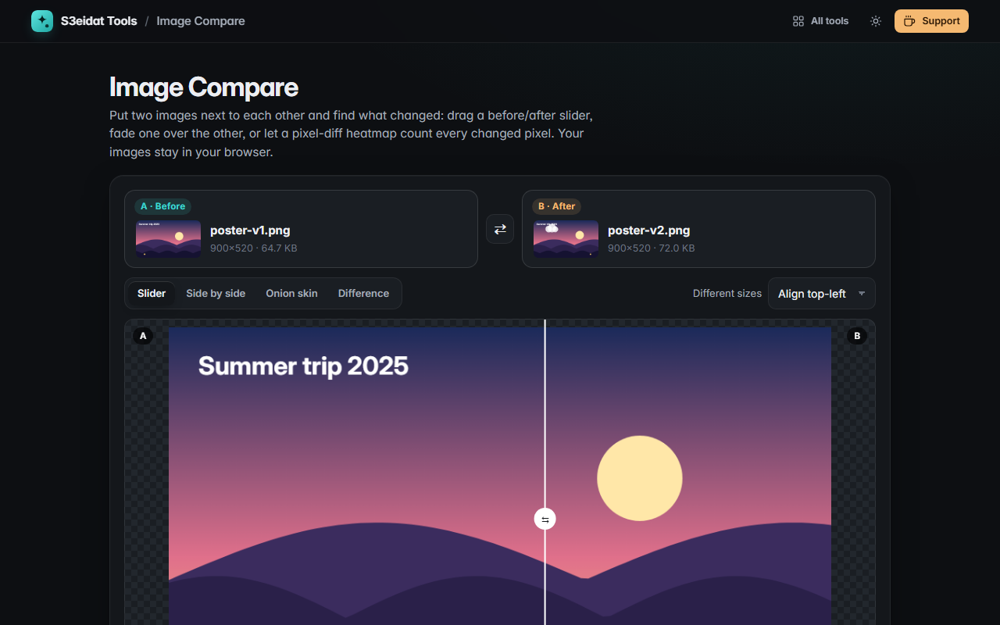

# Image Compare

> Spot the difference between two images. Free, private, and it runs entirely in your browser.

### ▶ [Open Image Compare](https://s3eidat.github.io/image-compare/)



## Features

- Four ways to compare:
  - **Slider**: drag a before/after line across the picture (arrow keys move it too)
  - **Side by side**: two views that **zoom and pan together**
  - **Onion skin**: fade B over A with an opacity slider
  - **Difference**: a pixel-diff **heatmap** (changed pixels yellow to red by how much they changed, the rest a faded grey)
    with a **threshold** to ignore tiny changes such as compression noise
- Always shows **changed pixels**, the **percentage** of the image and the **largest difference**
- **Different sizes** are handled: align top-left, align centres, or stretch B to A's size; areas only one image
  covers count as changed
- **Synced zoom and pan** in every mode: scroll or pinch to zoom, drag to pan, `0` fits, `1` is 100%
- **Export the diff** as a full-resolution PNG
- Paste images from the clipboard, drop two files at once, swap A and B

## Privacy

Your images never leave your device. There is no server, no account, no analytics.
The page ships with a strict Content-Security-Policy (`connect-src 'self'`), so the browser
itself blocks any attempt to send data anywhere.

## Run it yourself

It's plain HTML, CSS and JavaScript with no build step:

```bash
git clone https://github.com/s3eidat/image-compare
cd image-compare
python -m http.server 8000
```

Then open http://localhost:8000.

## Support

If this saved you time, **[buy me a coffee ☕](https://s3eidat.github.io/coffee/)**. It keeps every tool free.

---

Part of **[S3eidat Tools](https://s3eidat.github.io/)**: 100+ free, private tools that run in your browser. MIT licensed.
